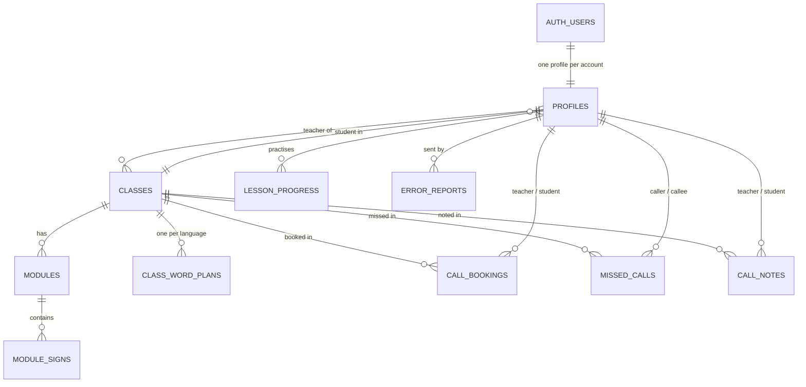

# LCSign Database Migrations: Final Defense Guide

This guide covers all 19 files in `supabase/migrations/`: what each one does in plain words, why it was needed, and what the panel might ask about it. The plain explanation comes first in each part. The technical detail follows.

> Older migration comments say **KamustaSign**, the app's working name. The app is **LCSign** everywhere a user can see it. Internal names did not change.

---

## Contents

1. [Before the defense: checklist](#1-before-the-defense-checklist)
2. [The basics in plain words](#2-the-basics-in-plain-words)
3. [Live database status](#3-live-database-status)
4. [The 19 migrations at a glance](#4-the-19-migrations-at-a-glance)
5. [Each migration explained](#5-each-migration-explained)
6. [The final database](#6-the-final-database)
7. [Who can do what](#7-who-can-do-what)
8. [How the data is protected: six locks](#8-how-the-data-is-protected-six-locks)
9. [Functions that changed over time](#9-functions-that-changed-over-time)
10. [Known limits (give honest answers)](#10-known-limits-give-honest-answers)
11. [Practice questions for the panel](#11-practice-questions-for-the-panel)
12. [How to check and how to apply](#12-how-to-check-and-how-to-apply)
13. [Glossary](#13-glossary)

---

## 1. Before the defense: checklist

- [x] **All 19 migrations are on the live database.** 0015 and 0019 were the last two; both were applied on 2026-11-22 and checked from outside the same day.
- [ ] Run the **status check query** in [section 12](#12-how-to-check-and-how-to-apply) once more on the day. All 19 rows should say `true`.
- [ ] Try the class plan's Letters / Numbers / Words switches as a teacher. They should save with no "needs the 0015 database update" message.
- [ ] Make sure every admin account that will be demoed has **2FA set up**. Since 0016, an admin without 2FA has no admin powers.
- [ ] Know the **super admin** account. Only that account can approve or change other admins (0014).
- [ ] Read [section 10](#10-known-limits-give-honest-answers) twice. Panels respect honest limits more than claims that the system is perfect.

---

## 2. The basics in plain words

**What is a migration?**
A migration is a script that changes the database one step at a time: it adds a table, a rule or a function. The scripts are numbered (`0001`, `0002`, …) and always run in that order. Running all 19 in order on an empty Supabase project rebuilds the whole LCSign database. This was tested on 2026-11-22 on a throwaway in-memory Postgres, and on 2026-11-17 on the separate red-team Supabase project.

**Why not just edit the old files?**
The old files have already run on the live database. Editing one would not change the live database, and the files would stop matching what actually happened. So every change is a new file. That is why some functions are written three or four times (see [section 9](#9-functions-that-changed-over-time)). The newest version is the one in force.

**What is Supabase?**
A hosted **PostgreSQL** database. It also provides sign-in (Auth), live messaging (Realtime, used for video-call signalling) and file storage. The app talks to the database directly, so the **security rules live in the database itself**, not in the app.

**Row Level Security (RLS), in one sentence:**
Every table has rules that decide, row by row, what the signed-in person may see or change. For example, "a student sees only their own progress" and "a teacher sees progress only for students in their own classes".

**Why the anon key in the app is not a secret:**
Every copy of the app carries the public "anon" key. That key alone opens nothing: an anon request can read only the app-version table (0018). Everything else needs a signed-in user, and RLS then limits that user to their own data. This was checked from outside on 2026-11-05: all tables refused anon, and admin functions were denied.

**Two kinds of database functions:**
- **SECURITY INVOKER** runs *as the caller*, so the caller's own RLS rules still apply. The default.
- **SECURITY DEFINER** runs *as the database owner* and skips RLS. LCSign uses it only for narrow jobs that must look past RLS, such as "is this class code taken by any class?". Each such function **checks who is calling first**, pins its `search_path`, and has `EXECUTE` revoked from `public` and granted only to signed-in users.

**"Auto-expose new tables" is off.**
The Supabase project was created with this setting off, which is the safer choice. The trade-off: every new table and function needs an explicit `GRANT`, or every request fails before RLS is even checked. That is why almost every migration ends with a `-- grants` block (see 0003).

---

## 3. Live database status

Checked on **2026-11-22** with read-only requests from outside, plus earlier session records.

| Migration | On the live database? | How we know |
|---|---|---|
| 0001 – 0010 | ✅ Yes | Later migrations build on them; the app works |
| 0011 – 0013 | ✅ Yes | Verified 2026-10-27 |
| 0014 | ✅ Yes | Applied and checked 2026-10-30 |
| 0015 | ✅ Yes | Applied 2026-11-22; `groups_off` column checked the same day |
| 0016 | ✅ Yes | Applied 2026-11-04 |
| 0017 | ✅ Yes | Applied 2026-11-05 |
| 0018 | ✅ Yes | 2026-11-22: `app_release` returns desktop/android 1.1.0 (min 1.0.0) |
| 0019 | ✅ Yes | Applied 2026-11-22; `error_reports` exists and refuses visitors who aren't signed in (permission denied, not "not found") |

Settings that live in the **Supabase dashboard**, not in migrations (the panel may ask):
- Realtime "Allow public access" is **off**, so calls use private channels (needed by 0011).
- Custom SMTP (Gmail) is set up and **Confirm email** is on. Emails carry 6-digit codes, not links.
- The minimum password length is 8.
- The sign-in rate limit is the Supabase default (30 per 5 minutes per IP). See [section 10](#10-known-limits-give-honest-answers).

---

## 4. The 19 migrations at a glance

| # | File | One-line summary | Phase |
|---|---|---|---|
| 0001 | `0001_schema.sql` | First tables: profiles, classes, assignments, submissions, scores | Foundation |
| 0002 | `0002_rls.sql` | Row Level Security: who sees which rows | Foundation |
| 0003 | `0003_grants.sql` | Table permissions (needed because auto-expose is off) | Foundation |
| 0004 | `0004_rls_call.sql` | A student can look up their own teacher (to call them) | Video call |
| 0005 | `0005_lesson_progress.sql` | Per-sign progress table and the "record an attempt" function | Classroom |
| 0006 | `0006_lesson_progress_rls.sql` | Rules for the progress table | Classroom |
| 0007 | `0007_lesson_pass_cooldown.sql` | 10-minute wait between counted passes (removed in 0012) | Classroom |
| 0008 | `0008_class_management.sql` | Add or remove students from classes; admin account list with emails | Classroom |
| 0009 | `0009_teacher_classroom.sql` | Teacher-run classes: join codes, invite lists, modules | Classroom |
| 0010 | `0010_lesson_progress_write_lock.sql` | Students can no longer edit progress directly | Security |
| 0011 | `0011_auth_hardening.sql` | 2FA enforced by the database, teacher approval, private call channels | Security |
| 0012 | `0012_class_plan_no_cooldown.sql` | Class word plans; one pass learns a sign | Classroom |
| 0013 | `0013_video_call_extras.sql` | Online status, missed calls, call notes | Video call |
| 0014 | `0014_account_approval.sql` | Every sign-up waits for approval; super admin | Security |
| 0015 | `0015_class_plan_groups.sql` | Teacher can switch whole sign groups off per class | Classroom |
| 0016 | `0016_admin_requires_2fa.sql` | Admin powers need a 2FA session | Security |
| 0017 | `0017_call_bookings.sql` | Teacher books call times; no double bookings | Video call |
| 0018 | `0018_app_release.sql` | Which app versions are current (update check) | Operations |
| 0019 | `0019_error_reports.sql` | App errors sent to the admins, deleted after 30 days | Operations |

**The story in four steps:**
1. **0001–0004:** the database as the manuscript first designed it (assignments and scores).
2. **0005–0009, 0012, 0015:** the classroom redesign. Progress is tracked per sign, and teachers run classes and write modules.
3. **0010, 0011, 0014, 0016:** security hardening after our own audits.
4. **0013, 0017, 0018, 0019:** video-call features and operations (updates, error reports).

---

## 5. Each migration explained

### 0001: Core schema

**Plain words:** creates the first five tables, from the manuscript's ERD. It also sets up a robot (a *trigger*) that automatically makes a profile whenever someone signs up.

**Adds:**
- The `user_role` type: `student`, `teacher`, `admin`.
- `profiles`: one per account (name, role, class). Linked to Supabase's `auth.users`.
- `classes`: name and teacher.
- `assignments`, `submissions`, `scores`: the original "teacher assigns a sign, student uploads a video, the app scores it" design.
- Indexes on the foreign keys, for fast lookups.
- The `handle_new_user()` trigger on `auth.users`, which creates the profile row.

**Worth knowing:**
- `profiles.class_id` and `classes.teacher_id` point at each other. To break that loop, the second foreign key is added only after both tables exist.
- `scores.submission_id` is `unique`: one score per submission, as the manuscript says.
- `confidence` is checked to be between 0 and 1.
- ⚠️ This first version **trusted the role sent at sign-up**, so anyone could sign up as admin through the API. Fixed in 0009, redesigned in 0014.

**Panel may ask:** *"Your ERD shows assignments and scores. Where are they in the app?"* They were the first design. The classroom redesign replaced them with `lesson_progress` and `modules` (0005, 0009), and 0011 locked the old tables. They remain only as history.

---

### 0002: Row Level Security

**Plain words:** turns on the "who sees which rows" rules for every table, plus the private storage folder for submission videos.

**Adds:**
- RLS enabled on all five tables.
- Helper functions `current_user_role()`, `current_user_class_id()` and `is_admin()`. These are SECURITY DEFINER **on purpose**: a rule on `profiles` that reads `profiles` would loop forever (RLS recursion). The helper reads that one value while skipping RLS.
- Policies:
  - **profiles:** read your own row; a teacher reads their class roster; an admin reads and manages all; you may update your own row but not your role.
  - **classes:** a student reads their own class; a teacher manages their own; an admin manages all.
  - **assignments, submissions, scores:** each side sees only its own.
- A private storage bucket `submissions`, with folder-per-student rules.

**Panel may ask:** *"Why is the role check a function and not a plain subquery?"* Because of recursion: the rule on `profiles` cannot query `profiles` under RLS. The definer helper does exactly one read and nothing else.

---

### 0003: Grants

**Plain words:** gives signed-in users permission to use the tables at all. RLS then decides which rows.

**Why:** with auto-expose off, Postgres refused every request with *"permission denied for table profiles"* **before** RLS ran. Postgres checks table-level `GRANT` first and row rules second.

**Detail:** grants go only to `authenticated`, never to `anon`. Every rule keys off `auth.uid()`, and nothing here is meant to be public.

**Panel may ask:** *"What is the difference between a GRANT and a policy?"* A GRANT is the door to the room (can you touch this table at all?). A policy picks which items in the room you can see.

---

### 0004: Student can see their teacher

**Plain words:** to call their teacher, a student's app needs the teacher's profile. 0002 gave students no way to read it, so the lookup silently came back empty.

**Adds:** the policy `"profiles: student reads own class teacher"`. It allows reading only a teacher profile, and only the teacher of the student's own class.

---

### 0005: Lesson progress

**Plain words:** the new classroom keeps **one row per student per sign** (attempts, passes, best confidence), instead of uploading videos.

**Adds:**
- The `lesson_progress` table. It is unique on (student, language, group, sign), and `language` must be `asl`/`fsl` and `sign_group` must be `letters`/`numbers`/`words`.
- The `record_lesson_attempt(...)` function, which records an attempt **in one SQL statement** (`insert … on conflict do update`).

**Why one statement:** two quick attempts sent as separate read-then-write steps would both read the same count, and one would be lost (a *race condition*). The single upsert is atomic.

**Panel may ask:** *"Why isn't the list of signs a database table?"* The sign list comes from each trained model's label list (`src/lib/curriculum.ts`). When a model is retrained with new words, no database change is needed. The client drops any sign the model no longer has.

---

### 0006: Progress rules

**Plain words:** students read and write only their own progress, teachers can read their own students' progress, and admins can read everyone's. Nobody can delete progress.

**Detail:**
- The rules are split per command (select, insert, update) so that `delete` is never allowed.
- Progress rows disappear only when the profile is deleted (`on delete cascade`).
- `record_lesson_attempt` gets an `EXECUTE` grant.

---

### 0007: Pass cooldown *(later removed)*

**Plain words:** a pass counted only if the previous counted pass on that sign was at least 10 minutes earlier. The goal was "practised on separate occasions".

**Adds:** the column `lesson_progress.last_passed_at`, and a new version of `record_lesson_attempt` with the 10-minute rule.

**What happened next:** 0012 removed the cooldown, because one pass now learns a sign (`MASTERY_PASSES = 1`). The `last_passed_at` column is still used: module progress counts only passes made **after the module was created** (`passedSince` in `src/lib/curriculum.ts`).

---

### 0008: Class management

**Plain words:** teachers could create a class but had no way to put a student in it. This adds safe functions for adding and removing students, and gives admins an account list that shows emails.

**Adds:**
- `admin_list_accounts()`: emails live in `auth.users`, which the app can never read directly. Only admins can call this function.
- `add_student_to_class(class, email)` and `remove_student_from_class(student)`.
- **Closes a hole:** the old self-update rule let a student write any `class_id` onto their own profile. They could join a class uninvited and then call its teacher. The new rule also pins `class_id`.

**Detail:** `add_student_to_class` was replaced in 0009 by the join-code and tick-the-box methods.

---

### 0009: Teacher-run classroom

**Plain words:** from the adviser feedback (October 2026), **teachers** run classes. They invite students by ticking names or by a join code, and they write **modules** (an ordered set of signs). Admins only manage accounts.

**Adds:**
- **Admins:** can read classes only, and no longer create, edit or delete them.
- **Sign-up fix:** sign-up can make only students or teachers, never admins.
- **Teacher rule fix:** before, a *student* could create a class naming themselves as its teacher. Now the role must be `teacher`.
- **Join codes:** 6 characters from `ABCDEFGHJKMNPQRSTUVWXYZ23456789`, with no 0/O/1/I/L so a child can copy it off the board. Added by `new_class_code()`, `join_class_with_code()` and `regenerate_class_code()`. Only a student with **no class** can join. Switching classes needs the current teacher to remove them first.
- **Tick-box invites:** `list_unassigned_students()` and `add_students_to_class()`. Students already in a class are never listed, so one teacher cannot see or take another teacher's roster.
- **Modules:** the `modules` table (title, language, group, due date, position) and the `module_signs` table, with RLS. `set_module_signs()` replaces a module's whole sign list in one call, so a save cannot leave it half written.

**Panel may ask:** *"How strong is a 6-character code?"* 31⁶ ≈ 887 million combinations. A code only lets a *class-less student* join, and the teacher can make a new code at any time.

---

### 0010: Progress write lock

**Plain words:** students could skip the "record attempt" function and send `{"passes": 3}` straight to the database, marking a sign learned without signing it. Now the function is the **only way** to write progress.

**Changes:**
- `record_lesson_attempt` becomes SECURITY DEFINER and checks three things: that you are the student named, that you are a student, and that the sign name is valid (1–64 characters).
- Students lose direct `insert`/`update`/`delete` on `lesson_progress`. Reading is unchanged.

**Honest limit:** the pass/fail result still comes **from the student's device**, because recognition runs on the device (privacy, and no video upload). A modified app could report a fake pass. See [section 10](#10-known-limits-give-honest-answers).

---

### 0011: Auth hardening *(the big security migration)*

**Plain words:** seven fixes from our own security audit.

1. **The database enforces 2FA.** Supabase gives a working session right after the password step. Someone could skip the 2FA screen and call the API directly. Now an account with 2FA gets nothing until its session is **aal2** (code entered). This is done with `mfa_ok()` plus a **restrictive** policy on every table, which is added on top of every other rule.
2. **Teacher sign-ups need admin approval.** The column `profiles.approved` and the helper `is_teacher()` mean an approved teacher on a 2FA-satisfied session. 0014 later extended approval to everyone.
3. **Every teacher check re-checks the role,** so a demoted or unapproved teacher cannot keep using an old class through the functions.
4. **Profile guard trigger** (`guard_profile_update`):
   - You can change only your own name.
   - `class_id` is cleared for non-students.
   - The **last admin cannot be demoted**.
   - Admins can update accounts but can no longer insert or delete profile rows.
5. **Old tables locked:** all grants on `assignments`, `submissions` and `scores` are revoked. Students could still insert their own "correct" scores before this.
6. **Private call channels:** one Realtime topic per student, `call:<class_id>:<student_id>`, which only that student and their approved teacher can join (`can_use_call_topic`). The old public channel let anyone with a class id listen in, or ring a student while pretending to be the teacher.
7. **Join codes** now come from a cryptographic random source (`gen_random_uuid`) instead of `random()`.

**Panel may ask:** *"What is aal1 and aal2?"* These are the Authenticator Assurance Levels in the sign-in token. aal1 means the password was checked. aal2 means the password plus the 6-digit authenticator code.

---

### 0012: Class word plans; no cooldown

**Plain words:** a teacher picks which words their class learns. Students then see only those words, and every progress figure counts only those words. Also, one pass now learns a sign, so the 10-minute wait was removed.

**Adds:**
- The `class_word_plans` table: one row per class and language, with `signs` as a list (up to 2000). No row means every word.
- RLS: the approved teacher of the class manages the plan, and students read their own class's plan. The 2FA restrictive policy also applies.
- `record_lesson_attempt` without the cooldown. It keeps the same checks as 0010.

**Why remove the cooldown:** with one pass needed, the wait only ever showed up as a "sleeping star" after the sign was already learned.

---

### 0013: Video call extras

**Plain words:** shows who is online, records missed calls, and lets the teacher keep notes after a call.

**Adds:**
- **Presence** rules on the same private call topics, with the same rule: only the student and their teacher.
- `is_call_partner(class, other)`: true only for a student and their own class's teacher, in either direction.
- The `missed_calls` table:
  - The caller writes the row.
  - The person called can read it and mark it seen.
  - Only `seen_at` can change (a column-level grant).
- The `call_notes` table:
  - The teacher saves what each side signed, plus practice results.
  - Text is capped at 5000 characters, and practice entries at 200.
  - Both people can read the notes, and the teacher can delete their own.

**Panel may ask:** *"Are call videos stored?"* No. Video goes device to device (WebRTC, with a TURN relay when needed). The database only handles who may connect, plus the text notes.

---

### 0014: Every account waits for approval

**Plain words:** one sign-in screen. Anyone can sign up as a student, teacher or admin, but **every new account waits** until an admin approves it. **Admin** sign-ups can be approved only by the **super admin** (the LCSign owner).

**Adds:**
- The `profiles.superadmin` flag. It can be set **only from the SQL Editor**, never from the app, and the super admin's own account cannot be changed through the app.
- `current_user_role()` returns *no role* until the account is approved, so every rule refuses a waiting account. It can still read its own profile, which is how the app shows "Waiting for approval".
- `is_superadmin()`, and updated guard-trigger rules:
  - An approved account cannot go back to waiting.
  - Only the super admin can approve or change admins.
- `decline_signup()`: an admin can turn down a sign-up that is **still waiting**, which deletes it. Admin sign-ups can be declined only by the super admin.
- Teachers see and add **approved** students only.
- 🐞 **Bug found and fixed:** `is_admin()` could return *NULL* instead of *false* for a role-less session, and `if not is_admin()` lets NULL through. A waiting sign-up could have listed every email. It is now always true or false.

**Bootstrap:** the super admin was made once with the `update … set superadmin = true` statement at the end of the file.

---

### 0015: Sign-group switches per class

**Plain words:** a teacher can switch whole groups off for a class. For example, a class that learns only ASL letters. Before this, overall progress always averaged all six groups (ASL/FSL × letters/numbers/words). A student who learned everything their class teaches could still show 17%.

**Changes `class_word_plans`:**
- New column `groups_off`: the list of groups this class does not learn. Only `letters`, `numbers` and `words` are allowed.
- `signs` may now be NULL, meaning "every word". A plan can then switch a group off without freezing the word list, so new words from a retrained model still show up.

**Applied last, after 0018 (2026-11-22).** That order is fine: there are no new tables or rules, and older app versions read NULL as "no plan" (the same meaning) and ignore `groups_off`. Applying it after 0018 was also tested on a throwaway database first.

---

### 0016: Admins must use 2FA

**Plain words:** admins can see and change every account, so their powers now need a session that has entered an authenticator code.

**Changes only `current_user_role()`:** for an admin, it returns no role unless the session is aal2. Every admin check goes through it. An admin without 2FA can still sign in and is sent straight to the 2FA setup screen. Students and teachers are unchanged (2FA stays optional for them).

**Lost authenticator:** in the SQL Editor, `delete from auth.mfa_factors where user_id = (…)`. The admin then sets 2FA up again at the next login.

---

### 0017: Call bookings

**Plain words:** the teacher books each call (which student, start, end). A student can call only during their booked time, from 5 minutes before the start until the end. The teacher can still call any of their students at any time. **The database makes double booking impossible.**

**Adds:**
- The `call_bookings` table:
  - The end must come after the start, and a booking can last at most 2 hours.
  - Two **exclusion constraints** (`btree_gist` extension) refuse any booking whose time overlaps another booking for the **same teacher** (across all their classes) or the **same student**. Back-to-back is fine, for example 2:00–2:15 then 2:15–2:30.
- RLS:
  - The teacher books, moves and cancels their own bookings, only with students in their own classes.
  - Each side reads only its own bookings, so a student never sees other students' times.
  - Moving a booking can change only `starts_at` and `ends_at` (a column grant).
- The `drop_call_bookings_on_class_change` trigger: a student who leaves a class, moves class or stops being a student loses their future bookings with that teacher.

**Panel may ask:** *"Why a constraint and not a check in the app?"* Two teachers' apps could book at the same moment. Only the database sees both at once. The constraint makes the overlap impossible, and the app turns error `23P01` into a friendly message.

---

### 0018: App release / update check

**Plain words:** one row per app type (desktop, Android) holds the latest version and the minimum allowed version. When it starts, the app shows "Update available", or blocks login with "Update LCSign" if it is too old.

**Adds:**
- The `app_release` table. Versions must look like `1.2.3`, and links must be `https://`.
- This is the **only** table `anon` may read, because the check runs before anyone logs in. It is read-only for everybody. Changes come from the Supabase dashboard (Table Editor), which bypasses RLS.
- A trigger keeps `updated_at` current.
- Seeded with desktop and android `1.1.0`, minimum `1.0.0`.

**How a release uses it:** see `docs/RELEASING.md`. In short:
1. Upload the build.
2. Set `latest_version`.
3. Raise `min_version` only when old copies must stop.

### 0019: App errors for admins

**Plain words:** when something goes wrong in the app, the app now tells the school's admins by itself, instead of waiting for someone to copy an error report. Admins see the list under "App errors" on their Accounts page. Nobody else can read it, and the database deletes each error after 30 days.

**Adds:**
- The `error_reports` table: what went wrong (the text, with emails, log-in tokens and computer user names removed by the app), where in the app, how many times, the app version, the kind of device, and which account was signed in. `before_sign_in` marks errors from before anyone signed in on that device; they go with the next account that does.
- `report_errors(p_entries)`: the **only** way in. It accepts a signed-in, approved account (an admin needs 2FA), at most 30 errors per call, 50 new rows per account per day and 20,000 rows in all, so nobody can fill the free database. The same error again updates its row (count, time) instead of adding one. It cuts long text and ignores a device clock set in the future.
- Rules: admins read and delete; nobody can insert directly or change a row. Rows go when the account is deleted (`on delete cascade`), and every call to `report_errors` first deletes rows older than 30 days.

**Why not a crash-reporting service (Sentry and the like)?** The students are minors. Their data stays in the school's own database, under the same rules as everything else.

---

## 6. The final database

### Tables (14)

| Table | Holds | Made in | Status |
|---|---|---|---|
| `profiles` | One per account: name, role, class, approved, superadmin | 0001 (+0011, 0014) | Active |
| `classes` | Class name, teacher, join code | 0001 (+0009) | Active |
| `lesson_progress` | Per student per sign: attempts, passes, best confidence, pass times | 0005 (+0007) | Active |
| `modules` | Teacher-written lesson sets | 0009 | Active |
| `module_signs` | The signs in each module, in order | 0009 | Active |
| `class_word_plans` | Which words (and groups) a class learns | 0012 (+0015) | Active |
| `missed_calls` | Unanswered calls | 0013 | Active |
| `call_notes` | After-call notes and practice results | 0013 | Active |
| `call_bookings` | Booked call times | 0017 | Active |
| `app_release` | Current and minimum app versions | 0018 | Active |
| `error_reports` | App errors from every device, for admins (30 days) | 0019 | Active |
| `assignments` | Original design | 0001 | Locked (0011) |
| `submissions` | Original design | 0001 | Locked (0011) |
| `scores` | Original design | 0001 | Locked (0011) |

Emails and passwords are **not** in these tables. They live in Supabase's `auth.users`, which the app cannot read. Only `admin_list_accounts()` and `list_unassigned_students()` show emails, and only to admins and approved teachers.

### Relationships



Deleting an account removes its profile, practice progress, bookings, call records and error reports (`on delete cascade`). A deleted teacher's classes stay, with no teacher (`on delete set null`). Deleting a class removes its modules, plans, bookings and call records. Its students stay, with no class.

### Functions (by job)

| Job | Functions |
|---|---|
| Who am I? (used by every rule) | `current_user_role`, `current_user_class_id`, `is_admin`, `is_teacher`, `is_superadmin`, `mfa_ok` |
| Accounts | `admin_list_accounts`, `decline_signup`, `other_admin_exists` |
| Classes | `new_class_code`, `join_class_with_code`, `regenerate_class_code`, `list_unassigned_students`, `add_students_to_class`, `remove_student_from_class` |
| Learning | `record_lesson_attempt`, `set_module_signs` |
| Calls | `can_use_call_topic`, `is_call_partner` |
| Operations | `report_errors` |

### Triggers (automatic actions)

| Trigger | On | Does |
|---|---|---|
| `on_auth_user_created` | new sign-up | creates the profile (waiting for approval) |
| `profiles_guard_update` | profile change | blocks forbidden changes (role, class, approval, super admin, last admin) |
| `profiles_drop_call_bookings` | student leaves a class | cancels their future bookings |
| `app_release_touch` | version row change | updates `updated_at` |

---

## 7. Who can do what

Final state with all 19 migrations applied.

| Action | Not signed in | Waiting sign-up | Student | Teacher (approved) | Admin (with 2FA) | Super admin |
|---|:-:|:-:|:-:|:-:|:-:|:-:|
| Read app versions | ✅ | ✅ | ✅ | ✅ | ✅ | ✅ |
| Read own profile | | ✅ | ✅ | ✅ | ✅ | ✅ |
| Change own name | | | ✅ | ✅ | ✅ | ✅ |
| Join a class with a code | | | ✅ (if no class) | | | |
| Record practice | | | ✅ own only | | | |
| See progress | | | own | own classes' students | everyone (read) | everyone (read) |
| Create classes, modules, word plans | | | | ✅ own | | |
| Invite / remove students | | | | ✅ own classes | | |
| Book calls | | | | ✅ own students | | |
| Video call | | | ✅ own teacher | ✅ own students | | |
| See classes | | | own | own | all (read only) | all (read only) |
| List accounts with emails | | | | | ✅ | ✅ |
| Approve students / teachers | | | | | ✅ | ✅ |
| Approve or change admins | | | | | | ✅ |
| Decline a waiting sign-up | | | | | ✅ (not admins) | ✅ |
| Change app versions | | | | | | dashboard only |
| Send the app's errors | | | ✅ own | ✅ own | ✅ own | ✅ own |
| Read / delete app errors | | | | | ✅ | ✅ |

A **student or teacher with 2FA turned on** has none of their rights until the session has entered the code (0011). An **admin without 2FA** has no admin rights at all (0016).

---

## 8. How the data is protected: six locks

A request has to get through **every** lock. Each one is the plain-words version of a database feature.

1. **The door (GRANT).** Can this kind of user touch the table at all? `anon` reaches only `app_release`. *(0003 and every migration's grants block)*
2. **The row filter (RLS policies).** Which rows can this person see or change? *(0002, 0006, 0009, 0012, 0013, 0017)*
3. **The 2FA gate (restrictive policies).** If the account has 2FA, the session must be aal2, on every table. *(0011)*
4. **The role check (helper functions).** Is the account approved? Is it a real teacher? Is the admin on a 2FA session? *(0011, 0014, 0016)*
5. **The field guard (trigger).** Even on your own row, you can change only your name. Approval, role, class and the super admin flag are protected. *(0011, 0014)*
6. **The data shape (constraints).** Lengths, value ranges, allowed words, no overlapping bookings, valid version numbers. *(throughout; 0017's exclusion constraints)*

Sensitive actions (joining a class, recording practice, inviting students, declining sign-ups) go through **one function each**. Each function re-checks the caller itself.

**Evidence we tested it:**
- `supabase/tests/rls_test.sql`: 169 access-rule checks covering 0001–0017. All passed on 2026-11-05, and 11 deliberately weakened rules were all caught. The file was updated for 0018 on 2026-11-17. On 2026-11-22 it got the 0019 checks (who can send, read and delete errors; the limits; the 30 days), and passed on a throwaway Postgres with all 19 migrations; 9 deliberately weakened 0019 rules were all caught. (The same day fixed a typo from 11-17 that had stopped the file from running at all.)
- **Red-team run, 2026-11-17**, on a separate test project with all 18 migrations: 126 attacks, 117 refused. The other 9 are the known limits in [section 10](#10-known-limits-give-honest-answers). Full report: `docs/RED_TEAM_REPORT.md`.
- **Outside probe on the live database with only the public key, 2026-11-05:** every table refused, admin functions were denied, and the call channels refused anon.

---

## 9. Functions that changed over time

The panel may notice the same function in several files. Each later file **replaces** the earlier version; only the newest is in force.

| Function | Versions | What changed |
|---|---|---|
| `handle_new_user` (sign-up) | 0001 → 0009 → 0011 → 0014 | trusted any role → no admin sign-ups → teachers wait → everyone waits, any role |
| `current_user_role` | 0002 → 0011 → 0014 → 0016 | plain read → needs 2FA if set → needs approval → admins need aal2 |
| `record_lesson_attempt` | 0005 → 0007 → 0010 → 0012 | atomic upsert → 10-min cooldown → only write path, checks caller → cooldown removed |
| `admin_list_accounts` | 0008 → 0011 → 0014 | + `approved` → + `superadmin` |
| `remove_student_from_class` | 0008 → 0009 → 0011 | teacher or admin → own teacher only → approved teacher only |
| `list_unassigned_students`, `add_students_to_class` | 0009 → 0011 → 0014 | → approved teacher → approved students only |
| `new_class_code` | 0009 → 0011 | `random()` → cryptographic random |
| `guard_profile_update` | 0011 → 0014 | + approval and super admin rules |
| `is_admin` | 0002 → 0014 | NULL bug fixed (always true/false) |

**Removed:** `add_student_to_class` (by email) was dropped in 0009.

---

## 10. Known limits (give honest answers)

| Limit | Why | How it is contained |
|---|---|---|
| A modified app could report a **fake pass** | Recognition runs on the student's device. No video is sent, which protects privacy. | The function only writes your own rows and checks the sign name. Teachers see attempts and can check signs live in a call. |
| The **booked-time rule** for students is enforced in the app | The ring is a live message, not a database row | The teacher's app declines rings from students with no booking open. The database still allows only the student and their own teacher on the channel. |
| **Join codes** have no guess limit | Low value: a code lets a class-less student join, nothing more | 887 million combinations, and the teacher can make a new code at any time |
| **Sign-in limit** is 30 per 5 minutes per IP (Supabase default) | A school lab behind one IP could hit it | Can be raised in the dashboard (about 150 suggested). Not changed yet. |
| A sign-in token stays valid up to **1 hour after logout** | How Supabase tokens work | Short expiry. All data rules still apply. |
| **Lost authenticator** needs a manual fix | We chose not to build a reset (security) | One SQL statement in the editor (see 0016) |
| Old tables (`assignments`, `submissions`, `scores`) still exist | History; dropping them is not needed | No grants since 0011, so nobody can read or write them |

---

## 11. Practice questions for the panel

**General**
1. *What is a migration, and why do you have 19?* → Section 2. Each one is a dated, ordered change. Running them in order rebuilds the database.
2. *Why did you choose Supabase/PostgreSQL?* → One service gives a relational database with row-level rules, sign-in with 2FA, and live messaging for calls. Rules in the database protect the data even if someone bypasses the app.
3. *Is your database normalized?* → Yes, except for two deliberate lists in `class_word_plans`: `signs` and `groups_off`. A plan is always saved and read as a whole, and `signs` is capped at 2000 entries. Module signs, which have an order, have their own table (`module_signs`).

**Security**
4. *The key is inside the app. Can't anyone use it?* → Section 2. That key reaches only the version table. Everything else needs a signed-in, approved user, and is then limited by RLS.
5. *How do you stop a student from seeing another student's progress?* → RLS on `lesson_progress`: `student_id = auth.uid()` (0006).
6. *What stops someone from signing up as an admin?* → Everyone waits for approval. Only the super admin approves admins, and the super admin flag can be set only in the SQL editor (0014).
7. *What if someone steals an admin's password?* → Admin powers need the authenticator code (0016), and the database checks this, not only the screen (0011).
8. *What if the only admin is demoted by mistake?* → The guard trigger refuses it (0011, 0014).
9. *Why do you use SECURITY DEFINER? Isn't it dangerous?* → It is used only where a function must look past RLS. Each function checks the caller first, pins `search_path`, and is executable only by signed-in users.
10. *How are video calls protected?* → A private channel per student, joinable only by that student and their approved teacher (0011, 0013). Video goes device to device and is never stored.
11. *How did you test security?* → Section 8: 169 rule checks, a 126-attack red team, and outside probes.

**Design**
12. *Why is the sign list not in the database?* → It comes from the trained models. Retraining changes it without a migration (0005).
13. *How do you prevent double-booked calls?* → Exclusion constraints in the database (0017).
14. *What happens to a student's data when they leave a class?* → Progress stays. Future call bookings are cancelled (0017 trigger).
15. *What happens when a teacher changes a module?* → Module progress counts only passes made after the module was created (`passedSince`, using `last_passed_at` from 0007).
16. *Why did you remove the 10-minute cooldown?* → One pass now learns a sign, so the wait only confused students (0012).
17. *How do users get updates?* → `app_release` with minimum and latest versions (0018).
18. *Why are there old tables you don't use?* → They are the original manuscript design. They were replaced by the classroom redesign and locked in 0011.

**Data privacy**
19. *What personal data do you store?* → Names, emails (in Supabase Auth), practice counts per sign, booked call times, and text call notes. No videos and no camera images. Recognition runs on the device.
20. *Can data be deleted?* → Deleting an account deletes its profile, progress and call records. A teacher's classes stay, with no teacher. A waiting sign-up can be declined, which deletes it (0014).

---

## 12. How to check and how to apply

### Which migrations are on a database?

Paste this into **Supabase → SQL Editor** and press Run. It only reads. Each row shows `true` if that migration's changes are present. It was tested on 2026-11-22 by applying the migrations one by one on a throwaway Postgres; it was correct after every step, and also when 0015 is skipped.

```sql
select migration, applied from (values
  ('0001 core tables',        to_regclass('public.profiles') is not null),
  ('0002 row-level security', exists (select 1 from pg_policies where schemaname = 'public' and policyname = 'profiles: read own row')),
  ('0003 grants',             to_regclass('public.profiles') is not null and has_table_privilege('authenticated', 'public.profiles', 'select')),
  ('0004 student sees teacher', exists (select 1 from pg_policies where schemaname = 'public' and policyname = 'profiles: student reads own class teacher')),
  ('0005 lesson_progress',    to_regclass('public.lesson_progress') is not null),
  ('0006 progress rules',     exists (select 1 from pg_policies where schemaname = 'public' and policyname = 'lesson_progress: student reads own rows')),
  ('0007 last_passed_at',     exists (select 1 from information_schema.columns where table_schema = 'public' and table_name = 'lesson_progress' and column_name = 'last_passed_at')),
  ('0008 class management',   to_regprocedure('public.remove_student_from_class(uuid)') is not null),
  ('0009 modules + codes',    to_regclass('public.modules') is not null),
  ('0010 progress write lock', to_regclass('public.lesson_progress') is not null and has_table_privilege('authenticated', 'public.lesson_progress', 'select') and not has_table_privilege('authenticated', 'public.lesson_progress', 'update')),
  ('0011 auth hardening',     to_regprocedure('public.mfa_ok()') is not null),
  ('0012 class word plans',   to_regclass('public.class_word_plans') is not null),
  ('0013 call extras',        to_regclass('public.call_notes') is not null),
  ('0014 account approval',   exists (select 1 from information_schema.columns where table_schema = 'public' and table_name = 'profiles' and column_name = 'superadmin')),
  ('0015 group switches',     exists (select 1 from information_schema.columns where table_schema = 'public' and table_name = 'class_word_plans' and column_name = 'groups_off')),
  ('0016 admins need 2FA',    to_regprocedure('public.current_user_role()') is not null and pg_get_functiondef(to_regprocedure('public.current_user_role()')) like '%aal2%'),
  ('0017 call bookings',      to_regclass('public.call_bookings') is not null),
  ('0018 app versions',       to_regclass('public.app_release') is not null),
  ('0019 app errors',         to_regprocedure('public.report_errors(jsonb)') is not null)
) as t(migration, applied)
order by migration;
```

### Applying a migration (0015 shown as the example)

1. Open the Supabase dashboard for the **LCSign** project and go to **SQL Editor → New query**.
2. Open `supabase/migrations/0015_class_plan_groups.sql`, copy **all** of it, and paste it.
3. Press **Run**. You should see "Success. No rows returned".
4. Run the status check above. `0015 group switches` should now say `true`.
5. In the app, open a class's learning plan as a teacher. The Letters, Numbers and Words switches should save without the "needs the 0015 database update" message.

Rules for applying:
- **Always in number order.**
- **Never edit a migration that has already run.** Write a new numbered file instead.
- Try it on a test project first if it changes rules.

### Rebuilding the database from scratch

On a new Supabase project:
1. Run 0001 → 0019 in order.
2. Set the dashboard settings in [section 3](#3-live-database-status).
3. Make the super admin with the statement at the end of 0014.

`README.md` ("Restoring") and `docs/RELEASING.md` have the operations side.

### Running the access-rule tests

`supabase/tests/rls_test.sql` runs everything inside one transaction and **rolls back**, so it leaves nothing behind. Even so, run it only on a **test project**, never on the live one. A clean run ends with `RLS tests: all passed`.

---

## 13. Glossary

| Term | Meaning |
|---|---|
| **aal1 / aal2** | Sign-in strength in the token: password only / password + authenticator code |
| **anon** | The role for requests with no one signed in |
| **authenticated** | The role for any signed-in request |
| **cascade** | Deleting a parent row also deletes its child rows |
| **constraint** | A rule on the data's shape (unique, check, foreign key) |
| **exclusion constraint** | Refuses two rows that "collide", here: overlapping times for the same person |
| **foreign key** | A column that must point at a real row in another table |
| **GRANT / REVOKE** | Give or take table- or function-level permission |
| **migration** | A numbered script that changes the database one step |
| **policy (permissive / restrictive)** | An RLS rule. Permissive rules are OR'ed (any one can allow); restrictive rules are AND'ed (all must allow). |
| **Realtime broadcast / presence** | Supabase live messages (call signalling) / who is online |
| **RLS** | Row Level Security: per-row access rules inside Postgres |
| **RPC** | Calling a database function from the app (`supabase.rpc(...)`) |
| **SECURITY DEFINER / INVOKER** | A function runs as its owner (skips RLS) / as the caller (RLS applies) |
| **trigger** | Code the database runs automatically on insert or update |
| **upsert** | Insert, or update if the row already exists, in one atomic step |
| **WebRTC / TURN** | Device-to-device video / a relay server used when a direct connection fails |
