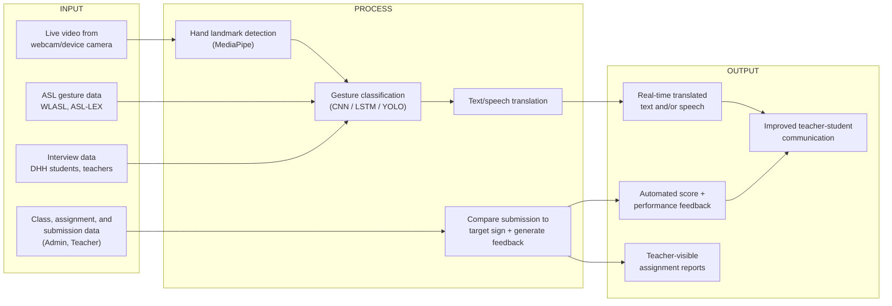
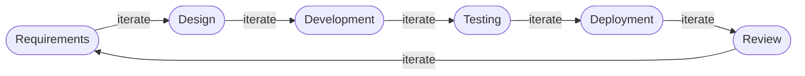
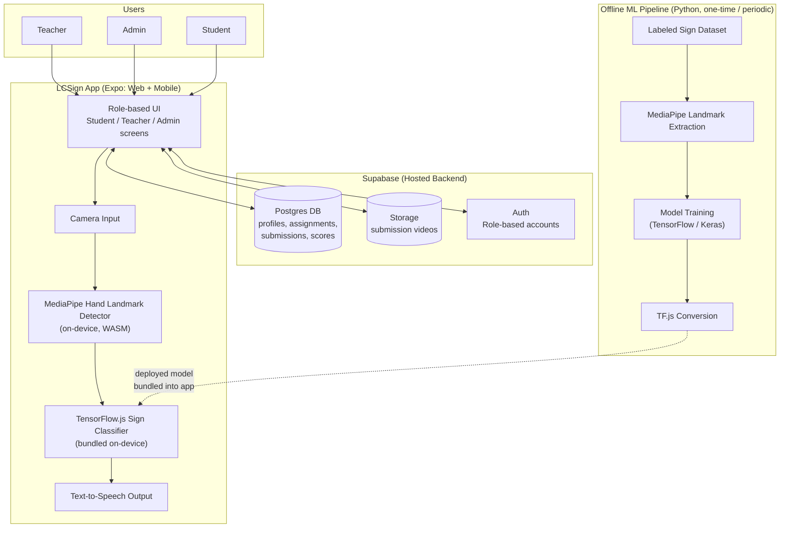
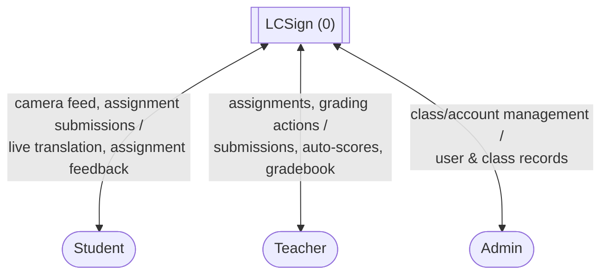
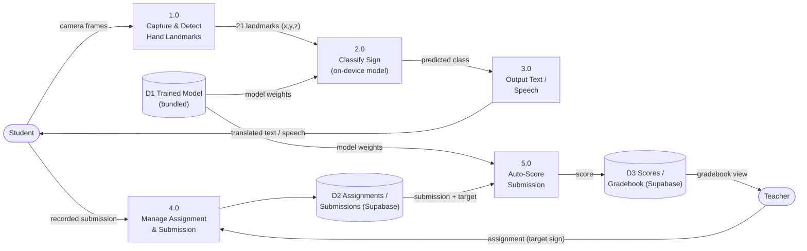
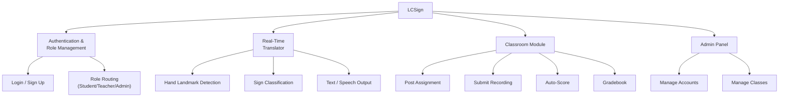
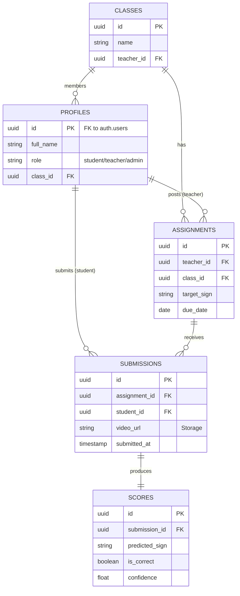

# LCSign — Manuscript Diagrams (Mermaid)

All 7 diagrams from the manuscript, reproduced as Mermaid code. Paste any block into
[mermaid.live](https://mermaid.live) to preview/export, or view directly in VS Code
(with the Mermaid preview extension) or GitHub, which render `.md` Mermaid blocks natively.

---

## 1. Conceptual Framework (IPO Model) — Chapter I, Figure 1

---

## 2. Agile Development Cycle — Chapter III, Figure 1

---

## 3. System Architecture — Chapter III, Figure 2

---

## 4. Context Diagram — Chapter III, Figure 3

Changed from 6 separate curved edges (one each direction per entity) to 3 combined
bidirectional edges with merged labels, and switched to top-down layout. This is what
caused the crowding in the original — three pairs of arrows all converging on the same
central node forced Mermaid to bend them around each other. One line per entity removes
the crossings entirely.

---

## 5. Data Flow Diagram (Level 1) — Chapter III, Figure 4

---

## 6. Functional Decomposition — Chapter III, Figure 5

---

## 7. Entity Relationship Diagram — Chapter III, Figure 6

---

**Note:** Diagrams 1–6 use flowchart syntax to approximate the original Graphviz-style
figures (rounded boxes, subgraphs). Diagram 7 uses Mermaid's native `erDiagram` syntax,
which is the more standard way to express that schema and will render with proper
crow's-foot notation.
